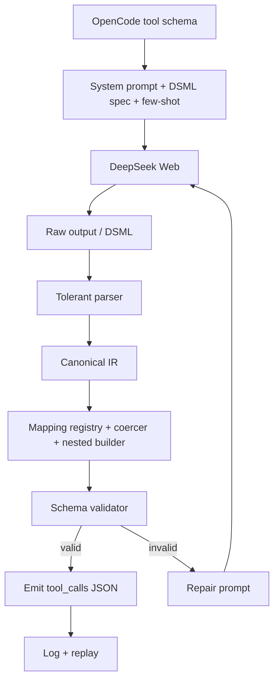

# Roadmap — deepseek-web-opencode

> Prompt-to-toolcall bridge: instruct DeepSeek through the prompt to emit tool calls in
> DSML, then parse and map them to OpenCode tool schemas. DSML is the prompt contract,
> not a native model format.

## Prinsip

- **Prompt adalah spesifikasi.** DSML lahir dari prompt, bukan dari model.
- **Parser harus toleran**, karena output model adalah teks bebas yang berniat menjadi DSML.
- **Mapping ke OpenCode schema** adalah inti nilai; tanpa ini, DSML hanya teks.
- **Repair loop wajib**, karena prompt-driven selalu bisa melenceng.
- **Observable:** raw output disimpan secara lokal untuk tuning prompt.

## Graph

## Fase

### Fase 0 — Kontrak Prompt (paling penting)

- [x] Tulis `prompts/dsml-spec.md`: format invoke, parameter, wrapper, dan contoh.
- [x] Few-shot: dua contoh untuk setiap tool utama yang tersedia (`bash`, `read`, `edit`, `grep`).
- [x] Versi prompt (`PROMPT_VERSION`) dan hash di request log.
- [ ] Baseline test: kirim prompt ke DeepSeek dan catat variasi output DSML yang muncul.
- [ ] Kumpulkan **fixture nyata** dari output model, bukan contoh buatan.

**Exit:** minimal 10 fixture DSML nyata dari model dan beragam tool.

### Fase 1 — Tolerant Parser → IR

- [x] Normalisasi fullwidth pipe dan toleransi wrapper/spasi/casing.
- [x] Parse beberapa `invoke` dalam satu output.
- [x] Incremental stream parser menjaga tag terpotong antar-chunk; incomplete block dipertahankan sebagai teks.
- [x] Output menjadi `ToolCallIR` (`name`, `params`, `raw`, `confidence`).
- [ ] Test terhadap fixture Fase 0.

**Exit:** semua fixture menjadi IR tanpa mapping.

### Fase 2 — Mapping + Coercion

- [x] Registry alias nama tool ke nama canonical OpenCode.
- [x] Registry alias parameter per tool.
- [x] Coercer string → number, boolean, object, atau array.
- [x] Nested builder, misalnya `todos.0.content` → `[{ content }]`.
- [x] Fuzzy match dengan threshold untuk nama tool yang melenceng.
- [ ] Ukur keberhasilan mapping pada fixture nyata.

**Exit:** minimal 90% fixture valid setelah mapping.

### Fase 3 — Validator + Repair Loop

- [x] Validasi IR terhadap JSON Schema OpenCode menggunakan Ajv.
- [x] Repair prompt ringkas yang menyebut output salah, format benar, dan meminta ulang.
- [x] Maksimal dua retry, lalu fallback ke teks.
- [x] Log status parse, mapping, validation, dan repair per tool/request.

**Exit:** kode hanya mengirim tool call yang lolos validasi schema.

### Fase 4 — Observability

- [x] Log raw output, IR, hasil validasi, dan tool call final secara lokal.
- [x] Replay tool: `npm run replay -- <id>`.
- [ ] Success rate per tool dan alert jika di bawah threshold.

**Exit:** tahap parse/mapping/validasi satu request dapat direkonstruksi dari trace lokal.

### Fase 5 — Hardening

- [ ] Fuzz test parser untuk variasi spasi, pipe, dan casing.
- [ ] Sediakan adapter interface agar provider lain dapat memakai pipeline yang sama.
- [ ] Review ToS dan lisensi sebelum rilis luas.

## Yang HARUS diingat

- Ini **bukan native function-calling**. Stabilitas bergantung pada prompt.
- Jika behavior DeepSeek berubah, perbaiki prompt terlebih dahulu, bukan langsung parser.
- Fixture dari output nyata lebih bernilai daripada fixture buatan.

## Definisi sukses

- 10 tool OpenCode utama dapat dipanggil end-to-end.
- Minimal 95% parse + mapping success pada fixture nyata.
- Repair loop pulih pada minimal 70% kasus invalid.
